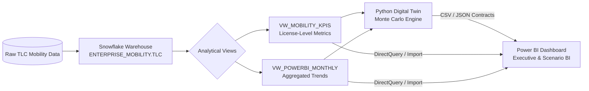

<div align="center">

# 🚖 Enterprise Mobility Intelligence & Urban Digital Twin
**End-to-End Cloud Data Warehouse, Monte Carlo Policy Simulator, and Executive BI Suite**

[](#)
[](#)
[](#)
[](#)

*Transforming raw NYC Taxi & Limousine Commission (TLC) fleet telemetry into predictive capacity planning, scenario stress-testing, and executive insights.*

---

[🏗️ Architecture](#-system-architecture) • [🗄️ Snowflake Warehouse](#-snowflake-data-warehouse) • [🎲 Digital Twin](#-urban-mobility-digital-twin) • [📊 Power BI Suite](#-power-bi-analytics) • [🚀 Quickstart](#-getting-started)

</div>

## 📌 Executive Overview

Urban transit networks operate under constant tension between rider demand, driver supply, fleet utilization, and environmental impact. **Enterprise Mobility Intelligence** bridges descriptive historical reporting with predictive operational modeling. 

The platform ingests monthly mobility records into a **Snowflake** data warehouse, feeds calibrated historical baselines into a **Python Monte Carlo Digital Twin**, and delivers interactive policy comparisons through **Power BI**.

---

## 🏗️ System Architecture



---

## 🗄️ Snowflake Data Warehouse

The SQL layer (`ENTERPRISE_MOBILITY.TLC`) establishes strict schema validation, null auditing, and semantic KPI views:

<details>
<summary><b>Click to explore Snowflake Schema & Semantic Views</b></summary>
<br>

* **Base Table (`MONTHLY_MOBILITY`)**: Stores monthly metrics partitioned by `LICENSE_CLASS`, tracking daily trips, farebox revenue, unique drivers/vehicles, road hours, credit card adoption, and shared rides.
* **Data Quality Auditing**: Automated checks verify record completeness (`COUNT_IF(... IS NULL)`), license class distribution, and temporal boundaries.
* **KPI Layer (`VW_MOBILITY_KPIS`)**: Computes derived operational efficiency ratios:
  * `TRIPS_PER_VEHICLE` = $\frac{\text{Trips Per Day}}{\text{Unique Vehicles}}$
  * `TRIPS_PER_DRIVER` = $\frac{\text{Trips Per Day}}{\text{Unique Drivers}}$
* **BI Serving Layer (`VW_POWERBI_MONTHLY`)**: Pre-aggregates total trips, active supply, farebox revenue, and weighted utilization metrics across all license classes for low-latency Power BI ingestion.

</details>

---

## 🎲 Urban Mobility Digital Twin

The Python simulation engine calibrates log-linear growth slopes, 12-month seasonality indices, and baseline fleet productivity from the trailing 36 months of historical data. It executes **500 Monte Carlo iterations** across a configurable forecast horizon (default: 12 months) to quantify uncertainty (`mean`, `std`, `p05`, `p95`).

### 🧪 Policy Scenarios Modeled

| Scenario | Demand $\Delta$ | Active Fleet $\Delta$ | Driver Supply $\Delta$ | Trip Time $\Delta$ | Productivity $\Delta$ | Shared Trips $\Delta$ | Emissions Factor $\Delta$ |
| :--- | :---: | :---: | :---: | :---: | :---: | :---: | :---: |
| **`baseline`** | `0%` | `0%` | `0%` | `0%` | `0%` | `0%` | `0%` |
| **`balanced`** | `+3%` | `+4%` | `+3%` | `-5%` | `+6%` | `+10%` | `-8%` |
| **`transit_priority`** | `+4%` | `+5%` | `+3%` | `-8%` | `+8%` | `+8%` | `-10%` |
| **`sustainability`** | `+2%` | `-3%` | `+1%` | `-3%` | `+4%` | `+25%` | `-22%` |
| **`disruption`** | `-5%` | `-15%` | `-12%` | `+12%` | `-5%` | `0%` | `+10%` |

### ⚙️ Core Simulation Outputs
* **Service Delivery & Capacity Pressure**: Evaluates served vs. unmet trip demand and flags fleet bottlenecks (`demand / capacity`).
* **Financial Coverage**: Projects daily covered farebox revenue under supply constraints.
* **Operational Emissions Proxy**: Models fleet emissions adjusted for vehicle road hours and shared-ride pooling discounts.

---

## 📊 Power BI Analytics

The `.pbix` report connects directly to the Snowflake views and Digital Twin output contracts (`mobility_scenario_summary.csv`, `mobility_twin_monthly_state.csv`, `mobility_monte_carlo_runs.csv`) to deliver:

* **Fleet & Revenue Command Center**: Historical trip volume, driver-to-vehicle ratios, and credit card payment trends.
* **License Class Benchmarking**: Comparative utilization, trip duration, and revenue efficiency across transit categories.
* **What-If Policy Explorer**: Interactive confidence intervals (`P05`–`P95`) comparing service rates, unmet demand, and emissions across all 5 policy scenarios.

---

## 🚀 Getting Started

### 1. Provision Snowflake Objects
Execute the warehouse DDL and analytical views in your Snowflake environment:
```sql
-- Creates ENTERPRISE_MOBILITY.TLC schema, MONTHLY_MOBILITY table, and KPI views
-- Run the provided Snowflake SQL script in your worksheet
```

### 2. Run the Digital Twin Simulation
Install dependencies and execute the Monte Carlo simulation against your exported dataset:
```bash
pip install numpy pandas
```
```bash
python mobility_digital_twin.py \
  --input data/monthly_mobility.csv \
  --output-dir mobility_twin_output \
  --months 12 \
  --runs 500 \
  --seed 42
```

### 3. Refresh Power BI
1. Open the Power BI report file (`.pbix`).
2. Update data source parameters to point to your Snowflake account/region and the `mobility_twin_output/` directory.
3. Click **Refresh** to load the latest warehouse metrics and simulation contracts.

---

<div align="center">
  <sub>Built for data-driven urban mobility planning and fleet optimization.</sub>
</div>
