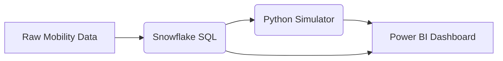

<div align="center">

# 🚖 Enterprise Mobility Intelligence
**Simple, Data-Driven Fleet Analytics & Urban Policy Simulator**

[](#)
[](#)
[](#)

*Tracking city taxi & ride-share demand, fleet supply, and "what-if" policy outcomes.*

</div>

---

## 💡 What This Project Does

1. **Stores & Cleans Data (Snowflake):** Organizes monthly NYC taxi/ride-share records and calculates core efficiency KPIs.
2. **Simulates the Future (Python):** Runs **500 Monte Carlo simulations** to predict how different city policies affect trip demand, driver supply, and emissions.
3. **Visualizes Insights (Power BI):** Turns raw numbers and simulation results into interactive executive dashboards.

---

## 🔄 How It Works



---

## 🧩 Project Components

<details>
<summary><b>1. 🗄️ Snowflake Data Warehouse (Click to expand)</b></summary>
<br>

Sets up the `ENTERPRISE_MOBILITY.TLC` database and builds clean views for reporting:
* **`MONTHLY_MOBILITY`**: Base table storing trips, farebox revenue, active vehicles, drivers, and shared rides.
* **`VW_MOBILITY_KPIS`**: Calculates daily `TRIPS_PER_VEHICLE` and `TRIPS_PER_DRIVER`.
* **`VW_POWERBI_MONTHLY`**: Summarizes monthly totals and averages for fast Power BI loading.

</details>

<details>
<summary><b>2. 🎲 Python Policy Simulator (Click to expand)</b></summary>
<br>

Tests **5 real-world scenarios** over a 12-month forecast using historical trends:

| Scenario | What Changes? | Expected Impact |
| :--- | :--- | :--- |
| **`baseline`** | No policy changes | Current trend continues |
| **`balanced`** | +4% fleet, +6% efficiency, +10% shared rides | Higher service rate, -8% emissions |
| **`transit_priority`** | +5% fleet, -8% trip duration | Faster rides, highest demand served |
| **`sustainability`** | -3% fleet, +25% shared rides | Major emissions drop (-22%) |
| **`disruption`** | -15% fleet, -12% drivers, +12% trip time | Fleet bottleneck & unmet demand |

</details>

<details>
<summary><b>3. 📊 Power BI Report (Click to expand)</b></summary>
<br>

Connects to Snowflake and the Python CSV outputs (`mobility_scenario_summary.csv`, `mobility_twin_monthly_state.csv`) to display:
* **Historical Trends:** Daily trips, revenue, and driver-to-vehicle ratios.
* **Scenario Comparison:** Interactive "What-If" charts comparing service rates and emissions across all 5 policies.

</details>

---

## 🚀 Quickstart

### Step 1: Set Up Snowflake
Run the SQL script in your Snowflake worksheet to create the tables and views.

### Step 2: Run the Simulation
```bash
pip install numpy pandas
python simulator.py --input monthly_mobility.csv --output-dir output
```

### Step 3: Open Power BI
Open the `.pbix` file, connect it to your Snowflake database and the `output/` folder, and click **Refresh**.
